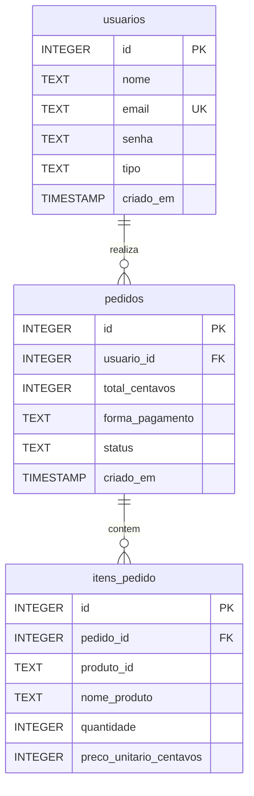

# Diagrama do Banco de Dados — Loja de Cupcakes

## Descrição dos relacionamentos

- Um usuário pode realizar vários pedidos (1:N).
- Um pedido pertence a um único usuário.
- Um pedido pode conter vários itens (1:N).
- Cada item pertence a um único pedido.
